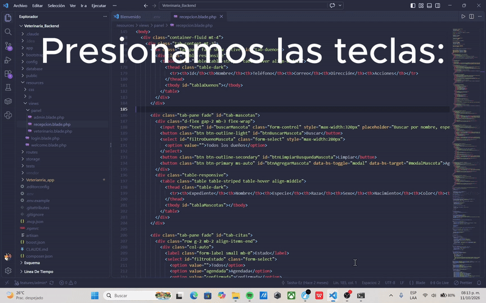

# Greap-Flash

Extensión de VS Code para buscar líneas de código o comentarios en el archivo activo usando búsqueda difusa (fuzzy) con ranking — sin necesitar el texto exacto.

Búsqueda difusa con ranking, directo dentro del archivo que tienes abierto en VS Code — sin scrollear, sin recordar la palabra exacta.

Funciona en MacOs, Linux y Windows.

# Creador
Este es un proyecto independiente hecho por Rafael Moreno Velez, es open source (codigo abierto), este proyecto es para hacer una extension en visual studio code, la cual te permita buscar lineas especificas de codigo o comentarios en el archivo en donde estes posicionado, usando o no el nombre correcto de la linea a buscar.

# Desarrollo

Ya existe una version v1.0.2 en el marketplace la cual funciona y esta disponible para su instalacion.

En desarrollo activo, aun faltan unas cosas por pulir y documentar, en estas semanas me estare encargando de la aceptacion de simbolos para que la bsuqueda por lineas  de codigo especificas sea mucho mas precisa, y de documentar el software y unos cambios dentro del repositorio de git.

Y de hacer unos cuantos test mas para ver como se comporta dentro de archivos muy grandes.

# Por qué

Aunque se que probablemente hay otras versiones de extensiones de fuera para buscar archivos como lo son Go-fuzzy, o swiper, esta ademas de su ligereza y su poco espacio que ocupa, te permitira buscar dentro de archivos grandes de forma rapida, aunque muy apenas recuerdes las palabras o letras, aparte de que es muy util para ir a comentarios en tu codigo, y lo mejor de todo es que solo se ejecuta si tu solo presionas las teclas vistas en la parte de uso del Read.me o con el comando, por lo que no te estara consumiendo recursos en segundo plano, aparte de que es super ligera y rapida, honestamente yo se que quiza ahi otras alternativas pero algunas como Go-fuzzy solo existen en linux/macos, esta te permitira hacer la busqueda difusa en cualquier sistema operativo en donde tengas visual studio code, de hecho es muy ligera y solo se ejecuta cuando la invocas.
Esta idea me surgio debido a la necesidad que tenia de que toleraran los buscadores errores de dedo y que buscara en archivos grandes de forma rapida lineas de codigo especificas y comandos, por lo que tiene especial prioridad en estos.

Por ejemplo:
Ctrl+F busca texto literal; Ctrl+Shift+F busca en todo el proyecto pero prioriza mal los resultados en archivos grandes. Si medio recuerdas una palabra de un comentario perdido en un archivo de miles de líneas, hoy no hay una forma rápida de encontrarla.

GreapFlash resuelve ese caso específico: escribes lo que recuerdas, aunque sea incompleto, y ves en vivo las líneas más probables ordenadas por relevancia.

# Cómo funciona

1. Índice invertido del archivo activo (se actualiza en vivo, reindexando el tokenizador con el archivo actual, cargandolo para cada archivo).
2. Fuzzy matching por subsecuencia (estilo fzf) sobre ese índice.
3. Ranking que prioriza inicio de palabra, coincidencias consecutivas y coincidencias en comentarios.
4. Resultados en un QuickPick nativo de VS Code, ordenados por score, actualizándose con cada tecla.

# Uso

- `Ctrl+Alt+G` (o el comando `GreapFlash: Buscar en archivo actual` desde la paleta de comandos).
- Escribe lo que recuerdes.
- Flechas para navegar, Enter para saltar a la línea.

## Roadmap

Lo que aun falta y voy a mejorar.
- [ ] Búsqueda en workspace completo (no solo archivo activo)
- [ ] Soporte para PDFs/libros abiertos como texto plano
- [X] Publicación en el Marketplace

## Limitaciones actuales del proyecto

Actualmente y a dia de hoy que este viendo esto, aun ahi unas cosas que faltan por resolver como la busqueda por simbolos como =>
, ni tampoco busca frases o comentarios partidos en varias lineas, esto llegara en un futuro, eso es un hecho.

## Instalar y desarrollar

Url del repositorio de GitHub (Proyecto):
https://github.com/Raphina-core/Greap-Flash.git

\`\`\`bash
git clone https://github.com/Raphina-core/Greap-Flash.git
cd Greap-Flash
npm install
npm run compile
\`\`\`
Presiona F5 en VS Code para probar en un Extension Development Host.

## Creditos

<a href="https://www.flaticon.es/iconos-gratis/uva" title="uva iconos">Uva iconos creados por Magnific - Flaticon</a>

<a href="https://www.flaticon.es/iconos-gratis/rayo" title="rayo iconos">Rayo iconos creados por Febrian Hidayat - Flaticon</a>

Muchas gracias a los de Flaticon, por permitirme usar sus iconos en mi logo.

## Licencia

MIT License — texto completo en LICENSE, en la raíz del proyecto.

